I'm a software engineer, and I'm building a game platform where anyone can play instantly, on any device, with no download and no account.

**Software engineer since 2021.** Some of what I've done:

- **FLAGS Software**, 2023 to now: I build the reporting, charts and mobile web app for tracking car manufacturing issues, in React and C# with ASP.NET.
- **CrowdProperty**, 2021 to 2023: I led the company's Vue.js front ends, helped launch CP Capital, and moved a legacy codebase to an event-driven design.
- **Birmingham City University**: first-class BSc in Computer Science, and the BCS Tazmmal Husein Memorial Prize for the top first-year grades.

&nbsp;

### Follow Popbrik while it's being built

&nbsp;
&nbsp;
&nbsp;
&nbsp;
&nbsp;
&nbsp;
&nbsp;

